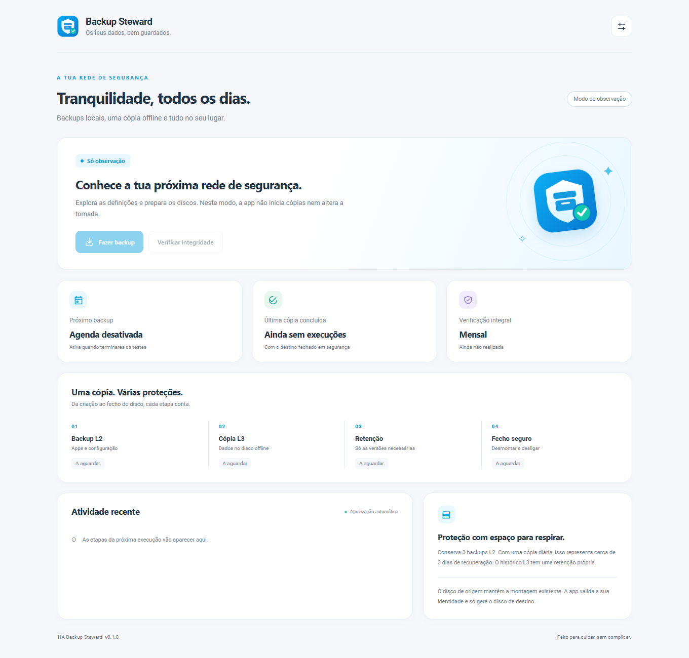

# HA Backup Steward


Encrypted Home Assistant backups, verified offline copies, and safe disk shutdown — packaged as one app with a lightweight companion integration.

> **Experimental 0.1.16.** Local automated tests and container builds are not HAOS hardware acceptance. Keep the established backup scripts and `80-local-media.rules` installed during the pilot. The app starts in **observation mode**, with its **schedule disabled**. Nothing is automatically installed on your Home Assistant.



The interface follows Home Assistant's visual language, supports light/dark mode and mobile screens, and uses no remote fonts, JavaScript CDN, analytics, MQTT broker or frontend framework. Screenshot data is simulated.

## What it does

- **L2:** asks the Supervisor for an encrypted, compressed native backup of Home Assistant, all installed apps, `ssl`, `share` and local apps; excludes `media`.
- Streams the resulting archive into a confined `.partial` file, validates length and archive identity, flushes it to disk, and only then publishes the final filename.
- Removes the native temporary copy only after delivery. A transfer failure keeps the native backup and existing archives.
- **L3:** mirrors configured local media trees to an offline disk, preserving replaced/deleted files in dated history directories.
- Checks every copy by file set/size, SHA-256-checks the L2 archive mirror, and optionally SHA-256-checks all source/mirror files.
- Validates exact ext4 mounts and filesystem UUIDs, blocks competing workers, and refuses suspicious source disappearance or excessive deletion.
- Flushes, unmounts, flushes the whole physical disk and confirms its final SCSI cache synchronization in the host kernel journal **before** switching power off.
- Reports L2 delivery, L3 outcome, retention failures and incomplete physical cleanup independently.

The app uses the documented Supervisor backup API directly. **Auto Backup is not a dependency or fork.** The established scripts and their patched Auto Backup remain the rollback path until migration acceptance.

## Installation

1. Add `https://github.com/rpmlourenco/ha-backup-steward` in **Settings → Apps → App store → Repositories** (called add-ons on older versions).
2. Install **HA Backup Steward**. The Supervisor builds the Dockerfile for `aarch64` or `amd64`.
3. Disk lifecycle operations require protection mode off. The app requests host D-Bus, read-only journal access and hardware access; it does **not** request the Docker socket or host PID namespace. Review [the security model](docs/SECURITY.md) before enabling execution.
4. Start the app and open its web interface. Keep observation mode and the schedule off during initial inspection.
5. Add this repository as a HACS **Integration** custom repository and download **HA Backup Steward**, or copy only `custom_components/backup_steward` into your HA custom components directory manually. Reload/restart Core as appropriate for installing a new integration.
6. In app settings, choose **Ligar ao Home Assistant**, copy the pairing key, and add **HA Backup Steward** under **Devices & services**.
7. Enter `http://<app-internal-hostname>:8100` and the pairing key. Find the app slug/hostname in Supervisor app information. The host port is not exposed by default. Pairing uses the app's own scoped key, never a Home Assistant long-lived or Supervisor token.

No installer here changes your existing Home Assistant YAML or deploy whitelist. Follow [the migration checklist](docs/MIGRATION.md) for a controlled pilot.

## Configuration

The **app is the sole schedule owner**. The integration has no timer or scheduling automation. Its buttons and `backup_steward.run` action are manual entry points.

Configuration is validated in app settings. Supervisor options bootstrap a new installation; saved in-app settings take precedence. The UI writes an atomic private configuration in `/data/steward/config.json`. Secrets are not returned by the normal configuration/status API.

| Setting | Default |
| --- | --- |
| Execution | Observation, no changes |
| Schedule | Disabled; when enabled, daily at 04:00 |
| Time zone | `Europe/Madrid`, configurable |
| Full checksum | First Sunday of each month; weekly/manual alternatives |
| L2 retention | 3 completed backups, configurable |
| L3 history | 30 days |
| Global integrity error ceiling | 1,000 distinct affected files / failed checks |
| Free-space floor | 100 GiB on destination |
| Sync deletion ceiling | 1,000 files / 100 GiB per source |
| Missing-source guard | Refuse a drop over 20% when mirror has at least 20 files |
| Backup creation/download deadline | 360 minutes each |

**Three daily L2 backups represent roughly three days of recovery**, not three weeks. Choose a larger retention if needed. All protective limits remain enforced when invoking an operation through the API.

Set source/destination UUIDs, paths and power switch explicitly. Defaults contain no real disk UUIDs, IP addresses, tokens or entity-specific switch IDs. Source paths must be distinct direct children of `/media`. Relative archive/test paths cannot traverse outside their allowed roots. No format, partition, filesystem repair or force/lazy unmount operation exists.

### Modes

- **Observe:** serves configuration/status; never starts backups or controls power.
- **Test:** creates real encrypted L2 archives under `<source>/backup-steward-test/level-2`, copies only that test tree to `<destination>/backup-steward-test/mirror`, never rotates L2 or prunes L3 history. It exercises the actual disk lifecycle.
- **Production:** L2 into the configured archive directory and complete L3 mirror/history. Can recognize the established `L2_NASRUI_apps_*` archives for retention, but only after a new Steward L2 is delivered and validated.

Test/production require an encryption key. The retired legacy-schedule acknowledgement is no longer required. Do not run the old scripts manually at the same time. A host transient `flock` lease shares the old L3 lock and blocks concurrent L3 workers, but cannot prevent an operator starting a separate legacy L2 creation.

### Checksums and scheduling

Every backup gets normal copy verification and L2 archive hashing. The configurable full checksum additionally reads every file in all configured source/mirror pairs. It is independent of the normal copy checks.

A failed or missed full checksum remains due until a successful production verification; the next backup retries it. A test checksum never clears the production deadline. The app deduplicates daily executions by local calendar date across DST/restarts. A missed 04:00 backup is caught up later that day if the app starts; it does not queue multiple historical days. A failed daily attempt is not retried automatically every minute. Manual retries remain available.

## Existing host rule and other apps

**`80-local-media.rules` stays unchanged.** NASRUI automount remains owned by that rule. The app validates it and never mounts/unmounts the source disk. Only the configured offline destination is managed by the app.

The FileBrowser startup hook and any unrelated packaged applications are out of scope. Existing backup filenames remain restorable using their original key; the new app cannot recover a lost key. Store the encryption secret/emergency kit somewhere accessible without HA.

### Manual backup and cancellation

**Fazer backup** opens a confirmation dialog with **Verificação neste backup**: automatic checksum policy, **Sem checksum integral** (`backup_only`) and full checksum (`backup_checksum`). The automatic option preserves catch-up for overdue checks. `backup_only` always skips the full source/mirror SHA-256 pass, even when overdue; normal copy size checks, L2 archive SHA-256, native archive validation, retention safeguards and safe disk closure remain enforced. The integration exposes a dedicated manual button and the same run action mode.

**Cancelar execução** stops an active backup or verification through the app or integration button. Copy/checksum subprocesses and downloads are interrupted and awaited. Native backup creation, mount/power transitions and an already running L2 retention step must finish before cancellation can proceed. Native job timeout/unknown outcomes keep power and recovery ownership; cancellation never force-cuts power. Cancellation is unavailable once finalization/history expiry and safe shutdown have begun.

A cancelled run has its own status, does not advance successful backup/checksum dates, and does not undo completed copies or retention. A native backup cancelled before durable delivery is preserved. A normal user cancellation is silent; failed safe cleanup produces an error notification and recovery obligation. App shutdown remains an interruption, distinct from an explicit user cancellation.

### Verify one area

**Verificar integridade** opens a selector with all areas or one exact configured source (for example NASRUI, immich or filebrowser). Choices are generated from configuration; no machine-specific area names are embedded in the code. Test mode offers only its separate test tree.

The app verifies SHA-256 for the selected source and its mirror, with the same global error ceiling and safe destination lifecycle. It creates no backup and performs no retention. A successful single-area run preserves the last global success/checksum dates and cannot satisfy the scheduled full-check deadline. Scheduled backups and existing verification buttons still cover all areas.

The authenticated run API and `backup_steward.run` action accept optional `source` for `mode: checksum`, using the exact configured source path. Omit `source` for all areas. Arbitrary paths and source selection for backup operations are rejected.

### Integrity overview

Integrity checks continue across configured source/mirror pairs after differences, missing files or read errors. The app shows each check as passed, failed, interrupted or not checked, plus a global count and up to eight example files. File-size checks are explicitly distinguished from SHA-256 checks. The integration Status sensor exposes the same per-area results as attributes.

`integrity_error_limit` (advanced settings, default 1,000) is shared by file-size, L2 archive and full SHA-256 checks during one execution. A file affected in overlapping checks counts once globally; each check still has its own count. An unavailable tree or command failure without a file-level report counts as a failed check. At the limit, the current rclone process is stopped and normal safe cleanup runs. No retry or automatic repair is performed.

Any integrity error leaves the execution failed, preserves the last successful backup/checksum timestamps and skips L3 history expiry. The disk is still closed safely when possible. Actual copy/sync failures, lost disk identity, unsafe paths and other safety failures continue to stop the workflow immediately.

## Status and recovery

The app keeps atomic bounded state and events in `/data/steward`. The integration exposes status/stage, L2/L3/retention results, last success/checksum, next run, running/schedule/recovery indicators, and manual backup/checksum/recovery buttons.

An interrupted app does not blindly restart a copy or power off the disk. The UI shows recovery required and blocks new executions. **Concluir fecho seguro** first checks native backup completion and physical identities. Unknown native job outcomes, disk disappearance without flush confirmation, or journal/identity failures intentionally require manual diagnosis. A restart of Core alone does not interrupt the app's work.

The app uses `backup: hot`: its own configuration and atomic state are included in L2 without stopping its worker. Restoring an in-progress state can require recovery/inspection; never assume an app backup is an image of HAOS or that it includes the external data disk.

## Development

```sh
python -m pip install -e .
python -m unittest discover -s tests -v
docker build -t ha-backup-steward:dev backup_steward
```

Run disk tests against fixtures only. Never mount `/dev`, host D-Bus, the HA filesystem or real disks into a test container. CI also validates component metadata/imports and builds the app. See [architecture](docs/ARCHITECTURE.md), [security](docs/SECURITY.md), and [migration acceptance](docs/MIGRATION.md).

MIT licensed. Rclone is bundled from its upstream versioned container image; see [third-party notices](THIRD_PARTY.md).

## Integration and repository icon

The repository and `custom_components/backup_steward/brand/` ship the same icon as the app, with a 512 px high-resolution variant. Home Assistant serves these local assets without a brands-repository submission. Update the integration through HACS and reload/restart Core to discover the new brand folder; a browser refresh may be needed for cached images. Older HACS frontends may still show their CDN placeholder on the repository card even when the HA integration icon works; see [HACS issue 5402](https://github.com/hacs/integration/issues/5402). This app does not patch HACS to work around that separate frontend limitation.

## App log

The Supervisor Log tab receives concise startup and workflow messages on stdout: version/mode, configuration ready, schedule enabled or disabled (time/zone/checksum), interface ready, execution ID, validation, power/mount, native creation and waiting, delivery, L3/checksum, retention, safe removal and result. Failure/recovery messages include the affected stage and safe HTTP method/path/status. Polling does not produce a log line on every request. Known encryption/pairing/Supervisor secrets are redacted.

The app requires the Supervisor `manager` role to read `/jobs/<uuid>` for native background-job completion. The narrower `backup` role permits creating backups but rejects that polling endpoint. Before powering the HDD, a harmless read-only permission probe verifies this exact access. No admin role is requested.

Home Assistant notifications are sent only for errors, including retention failures. Successful runs remain visible in the app and console log without a notification.

## Manual destination controls

Use **Ligar e montar** to power on and mount the configured destination without running a backup. It stays mounted until **Desmontar e desligar** confirms sync, unmount, kernel removal and final SCSI flush before switching off power. The integration provides the same two buttons.

Manual sessions reserve the backup lock: scheduled/manual backups and settings changes wait until the destination is closed. Observation mode never operates disks. An already powered or externally mounted destination is not adopted. Close files/apps using the destination before shutdown; an unsuccessful unmount or unknown flush leaves power on and reports an error. Restarting the app preserves the shutdown obligation and requires recovery. Manual controls never advance backup/checksum success timestamps, create archives or apply retention.

Rclone errors are relayed immediately with a bounded affected-file/reason report; progress is logged every minute. Copy/checksum phases identify the current source and record completion per source. Credentials and URLs are redacted; per-file success messages and arbitrary JSON fields are not dumped. The first eight error messages are shown, followed by a count if more occurred.

## UI connection safety

All operation controls are disabled in the initial HTML, before JavaScript or a status response arrives. Status reads keep controls locked until a structurally valid current response is available. Unavailable/malformed responses lock actions, including a confirmation dialog already open. Older out-of-order status responses cannot restore stale availability. A confirmed active backup keeps backup/verification/mount actions blocked and permits only the appropriate safe cancellation action.

The isolated browser regression suite runs in CI using Playwright/Chromium: `python tests/ui_connection.py`. An installed Chromium-family browser can be selected with `STEWARD_TEST_BROWSER` for local checks. Tests use temporary loopback fixtures and simulated status/API responses, never a real HA instance.
